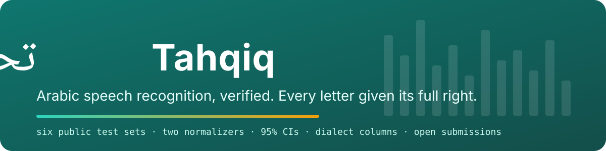

<p align="center"></p>

<p align="center">
  <a href="https://huggingface.co/spaces/HeshamHaroon/tahqiq"><b>Live leaderboard</b></a> ·
  <a href="https://huggingface.co/spaces/HeshamHaroon/tahqiq#submit"><b>Submit a model</b></a> ·
  <a href="https://huggingface.co/datasets/HeshamHaroon/tahqiq-results">Results dataset</a> ·
  <a href="https://huggingface.co/datasets/HeshamHaroon/tahqiq-requests">Request queue</a> ·
  <a href="docs/methodology.md">Methodology</a>
</p>

# Tahqiq (تحقيق)

**An independent, reproducible leaderboard for Arabic speech recognition.** Open-weight models are run by one harness on the same six public test sets, scored the same way, and published with every per-utterance output. Anyone can submit a model from the Hugging Face Hub; it is evaluated on Hugging Face compute and appears on the board with its results thread.

*Tahqiq* is the most exact style of Quran recitation, where every letter is given its full right. In everyday Arabic the word means verification.

## Why another board

Arabic ASR numbers are mostly self-reported, scored with different normalizers on different slices of data, and published without uncertainty. Tahqiq fixes the parts that make numbers incomparable:

| | Typical leaderboard | Tahqiq |
|---|---|---|
| Who runs the evaluation | model authors | this harness, same code and settings for every system |
| Normalization | one, often undocumented | two published normalizers: `elm` (a verified 1:1 port of the Open Universal Arabic ASR Leaderboard's, for comparability) and `tolerant` (orthographic folding + spelling variants) |
| Uncertainty | none | 95% bootstrap interval on every number; paired delta and McNemar test against Whisper large-v3 |
| Beyond WER | none | numeral probe (digits and spoken numbers), named-entity probe (people, places, organizations) |
| Dialects | aggregate only | per-dialect columns wherever the test set carries labels |
| Production fit | none | measured RTFx, per-file latency, peak VRAM, load time; declared streaming, timestamps, max input, license, size |
| Replication | partial | manifests with audio hashes, every hypothesis, `run.json` per system, deterministic slices |

## Test sets

The six public sets used by the Open Universal Arabic ASR Leaderboard, reconstructed utterance for utterance from its published manifests. Audio is obtained under each set's own terms and never redistributed; only outputs are published.

| Set | Utterances | Hours | Dialect labels |
|---|---:|---:|---|
| SADA | 6,193 | 10.8 | Najdi, Hijazi, Gulf, MSA, Egyptian |
| Casablanca | 6,818 | 7.9 | Algeria, Egypt, Jordan, Mauritania, Morocco, Palestine, UAE, Yemen |
| Common Voice 18 (ar) | 10,471 | 12.7 | mostly unlabelled |
| MASC clean | 8,612 | 10.5 | unlabelled |
| MASC noisy | 9,394 | 8.9 | unlabelled |
| MGB-2 | 5,365 | 9.6 | unlabelled, mostly MSA broadcast |

Every run also scores a fixed, seeded, dialect-stratified **common slice** of about 1,000 utterances per set. Community submissions are evaluated on that slice and are marked accordingly on the board.

## Submit a model

1. Open the [Space](https://huggingface.co/spaces/HeshamHaroon/tahqiq), tab **Submit a model**, sign in with Hugging Face (the only permission asked is to open a discussion in the request queue).
2. Enter the model id. Transformers-native ASR architectures (Whisper, wav2vec2/HuBERT CTC, Qwen3-ASR, Cohere Transcribe, Voxtral) run automatically. NeMo checkpoints and repositories that need `trust_remote_code` are parked for a maintainer.
3. The worker evaluates it on ZeroGPU, scores it, measures timing, and replies in the request thread with the numbers and a link to every per-utterance output. Typical turnaround is under an hour.

## Leaderboard snapshot

<!-- tahqiq:table:start -->
_Generated from the live results; see the Space for the current board._
<!-- tahqiq:table:end -->

## How a number is produced

1. **Inference.** Zero-shot, as released, greedy decoding, Arabic forced where the model takes a language hint. Decode settings and environment are recorded in `run.json`.
2. **Normalization.** Reference and hypothesis go through the same normalizer. `elm` is tested for string equality against the vendored original; `tolerant` adds NFC, tatweel, alef/alef-maksura/ta-marbuta/hamza folding, digit unification, and a published variant table.
3. **Scoring.** Corpus-level WER and CER per set; utterance-level percentile bootstrap (2,000 resamples) for the interval; paired bootstrap and McNemar against the baseline on shared utterances; Wilson intervals for the probes.
4. **Publication.** `scores/<model>.json` and `results/<model>/` land in the results dataset; the board renders `board.json`.

Full details: [docs/methodology.md](docs/methodology.md).

## Reproduce a row

```bash
git clone https://github.com/h9-tec/tahqiq && cd tahqiq
uv sync --extra data --extra gpu
# obtain a test set under its own terms, then
uv run python scripts/prepare_data.py casablanca
uv run python -m tahqiq.runner --model whisper_large_v3_turbo --dataset casablanca
uv run python scripts/publish.py whisper_large_v3_turbo --no-upload
```

`scripts/build.py check` refuses any run whose manifest hash differs from the committed one.

## Repository layout

```
tahqiq/            harness: normalizers, metrics, manifests, runner, model adapters, Hub I/O
scripts/           prepare_data, runner entry points, publish, timing, burst/orchestration, worker tooling
data/              manifests (with audio hashes), Elm's reference manifests, probes, model cards, inventory
space/             the static leaderboard Space
space_worker/      the ZeroGPU evaluation worker Space
docs/              methodology
tests/             normalizer parity, metrics, pipeline, adapters
```

## Scope and policy

Open-weight models only in v0. Vendors domiciled in the GCC appear only after written opt-in. Hosted APIs whose terms forbid benchmarking are excluded. All published text is numeric; the board makes no claims beyond the measured values.

## Citation

```bibtex
@misc{tahqiq2026,
  title  = {Tahqiq: a reproducible leaderboard for Arabic speech recognition},
  author = {Haroon, Hesham},
  year   = {2026},
  url    = {https://huggingface.co/spaces/HeshamHaroon/tahqiq}
}
```

## License

Code Apache-2.0. Manifests, probe files and published results CC-BY-4.0. Audio is never redistributed.
